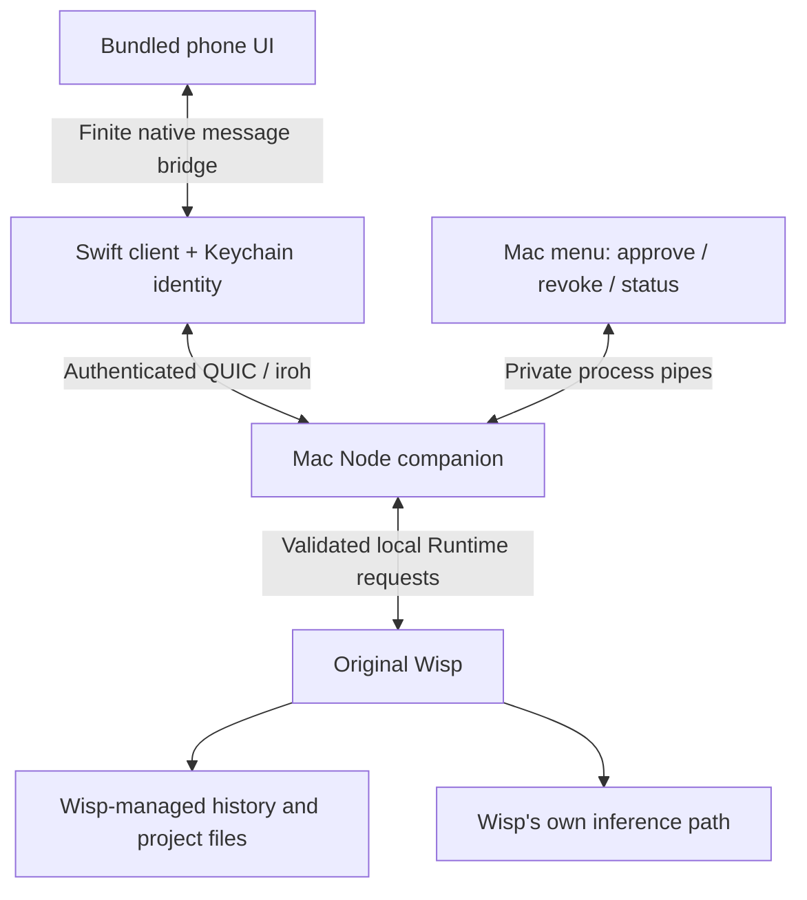

# How Wisp Remote works

Wisp Remote adds an iPhone control surface to Wisp already running on the owner's
Mac. It does not replace Wisp's engine, create another model account or copy the
entire chat database into a new service. This document describes the implemented
system, including the boundaries that are still experimental.

## 1. The four pieces

| Piece | Job | Main source |
| --- | --- | --- |
| iPhone app | Pair with a Mac, show chats, pick files, provide native keyboard/copy/haptics, reconnect | `native/App/`, `native/Sources/RemoteCore/` |
| Bundled phone interface | Render messages and mobile controls; hold an unsent draft in memory | `public/mobile.*`, `public/account-settings.*` |
| Mac Remote | Show status and pairing approval; authenticate phones and translate allowed operations | `native/MacMenu.swift`, `src/start-companion.js`, `src/iroh-companion.js`, `src/companion-rpc.js` |
| Original Wisp | Store conversations, run its agent, enforce its permissions and communicate with model infrastructure | Separately installed proprietary application; not included in this source |

The iPhone uses WKWebView for the bundled HTML/CSS/JavaScript interface, inside a
native Swift application. It loads a private local URL scheme, not a remote
website. Native code owns the encrypted connection, device identity and file
picker. The Mac's AppKit menu also uses bundled UI, and launches a Node process
through private standard-input/output pipes.

## 2. What happens during pairing

1. Each device creates its own private identity key. The application stores it in
   that device's Keychain, not in a repository, QR code or web page.
2. **Connect iPhone** creates an invitation containing the Mac's public identity,
   routing information and a random one-use token. It expires after two minutes.
3. The phone scans it and presents the identities for review. The ticket's public
   key must match the invitation; the app does not silently replace a saved Mac.
4. The Mac displays a pending phone. The owner approves or rejects it. Knowing the
   QR alone does not authorize chat access.
5. Approval stores the phone's public key in the Mac allowlist. Later requests are
   authorized using the key authenticated by the connection, not a name supplied
   in a request.

Revoking a phone closes its connections and blocks subsequent requests. It does
not undo an action Wisp already accepted or erase existing Wisp conversations.
Pairing limits and envelopes are specified in [the companion contract](docs/companion-contract.md).

## 3. Direct connections and relays

**iroh** is the existing transport library; this project does not invent a cipher.
It uses authenticated encrypted QUIC connections and tries to establish a usable
route between endpoints. A relay can forward encrypted traffic when direct
connectivity is unavailable. Both routes still require the paired device identity.

A relay is not the chat database or the AI model. It can observe network metadata
such as IP addresses, timing and volume, and can make the connection unavailable.
Free relay availability is not guaranteed. Transport encryption protects this hop;
it does not extend an independent guarantee over Wisp's inference/provider path.

The application protocol has a finite operation list, bounded frame sizes and
connection limits. It is not an unrestricted network proxy. Each public-key
identity may have two connections, allowing reconnect overlap without taking the
entire eight-connection pool. Invalid event subscriptions return an error and end.
Known dependency advisories are disclosed in [the security review](docs/security-review.md).

## 4. Opening the app and reading a conversation

The bundled interface can appear before a network connection is ready. On a fresh
launch it opens a **New Chat draft**; it does not create an empty Wisp conversation
until a message is sent. Returning from the background keeps the current view and
in-memory draft.

The phone loads a bootstrap snapshot from the Mac: available conversations,
projects, models, preferences and capability flags. Opening a conversation obtains
its current history and subscribes to changes. The companion registers its event
listener before building the snapshot, buffers changes during that work, and then
sends the snapshot followed by buffered and live events. This avoids losing the
small interval between the initial read and subscription.

Model metadata is cached briefly in Mac memory and concurrent reads are combined.
Chats and permissions do not become a persistent phone-side cache. There is no
promise of instant startup on every network or after a sleeping Mac.

The green Mac indicator requires a recent **application-ready** signal from the
phone. A successful transport handshake alone is not enough. The signal expires,
so a suspended or disconnected phone cannot leave the status permanently green.
Wisp-open status is checked separately from phone connectivity.

## 5. Sending a message

1. The interface validates the draft and selected mode. For a new draft it first
   creates the corresponding Wisp session; navigation alone creates nothing.
2. Swift checks the finite route and request schema, then sends the request over
   the authenticated connection.
3. The Mac rechecks trust, validates fields and limits, and maps the request to the
   local Wisp operation. Model/Thinking encodings are version-specific.
4. Wisp runs the turn. The companion relays normalized text, tool activity and
   completion events to the phone.
5. If the connection drops during a write, the app does not assume either success
   or failure and blindly resend. Stable message identifiers and read-only status
   reconciliation are used where supported; unresolved delivery stays explicit.

The phone and companion render messages as text/constructed DOM nodes, not
executable model-supplied HTML. Disconnecting ends transport/subscriptions, not an
already-running Wisp task. **Stop** is a separate deliberate operation.

## 6. Attachments

Files enter through the native iPhone picker. Preparation is bounded to 10 files,
5 MiB per prepared file and 15 MiB total. Supported UTF-8 text is size-checked;
PDFKit extracts text from supported PDFs without OCR; images are bounded, resized
and encoded as JPEG. Image-only/encrypted PDFs and unsupported or excessive files
produce an error rather than an arbitrary upload.

Prepared content stays in memory for the draft and travels in bounded encrypted
chunks. The Mac binds every upload to the authenticated phone and destination
session. Another peer cannot name an upload and claim it. The Mac creates the
native content blocks Wisp expects; the phone cannot supply an arbitrary Mac path.

The picker can also leave a temporary import copy inside the iOS application
container. Immediate removal of that copy is not currently implemented. Accepted
attachments and chat history then follow Wisp's own storage behavior; Remote does
not promise to delete them. Details: [attachment contract](docs/attachments-contract.md).

## 7. Agent actions, Sandbox and project removal

Remote preserves explicit approval: supported pending actions offer **Allow once**
or **Deny**. It does not enable bypass policies or auto-approve an agent. The paired
phone nevertheless has substantial owner-level authority, not a restricted guest role.

Sandbox controls are intentional Mac-wide changes. Each request contains exactly
one boolean, reads fresh state, preserves the other field and approval policy,
serializes concurrent writes, and verifies the result. Network access cannot be
changed through this control while Sandbox is off. Unknown write outcomes require
a fresh read and a new deliberate action; they are not automatically replayed.

Removing a project group confirms a bounded list of conversations, stops/removes
those conversations through Wisp, and leaves the folder and project registry intact.
Partial or unknown removal is reported instead of silently retrying. The original
Desktop does not continuously poll every external change; its open window may
need a reselect/remount to show the current state.

## 8. The boundary with proprietary Wisp

This integration was established by inspecting the installed Desktop 0.2.7 and
Runtime 0.1.3. The Runtime routes are **not presented as an official supported public
API**. The companion validates a protected local discovery record, checks a live
process, expected Runtime version and loopback address, and uses the existing local
credential only inside Mac memory. It never forwards that credential to the phone.

Project membership comes from Wisp's native selected-project registry. Operations
use the current Runtime; Remote does not patch Wisp's executable or start a second
Runtime against its storage. It does perform requested writes through Runtime and,
when adding a project, its selected-project registry. “Unmodified application” does
not mean a user-triggered operation cannot change Wisp-managed data.

The appearance also comes from Wisp UI references. Builds now copy independently
sourced, open-license fonts from `assets/fonts/` after checking their SHA-256
hashes against its manifest. CSS and native resource allowlists use only these
files; the source exporter permits those exact reviewed font bytes. Both apps
include the licence notices. No build step reads Wisp's executable or extracts
its assets. Ascella Pixel and the original Wisp PNG were removed; the generated
companion mascot remains. This change does not settle rights to that mascot, the
Wisp-derived interface or the Runtime integration.
See [provenance](docs/provenance.md) for the reported Runtime approval and the
separate scope of asset rights.

## 9. Where information lives

| Information | Location / lifetime |
| --- | --- |
| Private device keys | Own Keychain items on Mac and iPhone; no cloud synchronization requested |
| Approved phone public keys and Remote preferences | Mac application support state outside the app bundle |
| Saved Mac public identity/routing information | iPhone app preferences |
| Current phone conversation/draft | Memory of the bundled view; explicit Disconnect destroys that surface |
| Prepared/uploading attachment content | Bounded phone/Mac memory; picker import copies may also be temporary local files |
| Accepted chats, files and agent work | Original Wisp's stores and selected project files |
| Build/signing configuration | Local development machine; personal signing file is ignored by Git |

No companion analytics, companion cloud history or third-party browser scripts are
configured. OS behavior, compromised devices, original Wisp and model providers are
outside an independent Remote confidentiality guarantee.

## 10. Source map and maintenance

- `src/`: pairing, transport, request validation, Wisp adapter, normalized messages,
  project metadata and bounded attachment handling.
- `native/App/`: the iPhone application's SwiftUI/WebKit shell and native controls.
- `native/Sources/RemoteCore/`: Swift transport, identity stores and finite policies.
- `native/MacMenu*.swift`: Mac lifecycle, windows, status and local controls.
- `public/`: bundled mobile/menu interfaces; no remote frontend build service.
- `scripts/`: setup, diagnosis, resource preparation, app builds and source packaging.
- `tests/`, `native/Tests/`: synthetic behavior and boundary regression checks.
- `docs/`: setup, operation, contracts, provenance and known limitations.

The existing optional Tailscale rollback is separate from native iroh. Its adapter
checks a pinned phone's network identity, and its loopback bridge requires a fresh
per-launch capability shared only in process memory. Standalone HTTP launches are
disabled. It is not part of the normal iPhone setup.

A Wisp or transport upgrade needs compatibility testing on both sides, not just a
version-number edit. The current source uses pinned dependencies; changes to either client must preserve the shared protocol.
