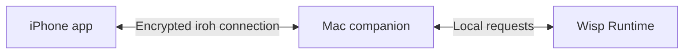

# Unofficial Wisp Remote

Use Wisp on your Mac from your iPhone. Continue conversations, send files and
respond to agent approval requests while your Mac does the work.

An independent companion by [web3illy](https://x.com/web3illy). Requires
[Wisp](https://usewisp.io/) running on your own Mac. This is experimental software,
not an official Wisp app.

**[Install on Mac and iPhone →](docs/installation.md)**

## What it does

- Opens the same chats and projects you use on the Mac.
- Streams replies and tool activity; lets you approve, deny or stop supported actions.
- Sends text, images and text extracted from PDFs. Add files with **+** or drag them from Files into the iPhone chat.
- Supports model selection, Thinking, Usage and Wisp's Mac-wide Sandbox controls.
- Pairs by QR code with approval on the Mac, then reconnects over an encrypted connection.

The Mac must stay awake with Wisp and the companion running. Artifacts, Connectors
and Transcripts remain Mac-only. Chat pinning and push notifications are not
supported. An open Wisp Desktop chat may need to be reselected to show phone changes.

## Install

You need an **Apple Silicon Mac**, **Xcode 26+**, **Node.js 24+**, an
**iPhone on iOS 17.5+**, and a compatible Wisp installation. The current integration
supports **Wisp Desktop 0.2.7 / Runtime 0.1.3**; the installer checks compatibility.

There are no prebuilt app downloads yet. The Mac app builds locally without a
paid Apple membership. The iPhone app uses your own Apple Account in Xcode;
free Personal Team signing needs renewal every seven days.

Once the prerequisites are installed:

```sh
git clone https://github.com/web3illy/unofficial-wisp-remote.git
cd unofficial-wisp-remote
bash scripts/setup.sh mac
bash scripts/setup.sh prepare-ios
open native/WispRemote.xcodeproj
```

In Xcode, choose your Personal Team, a unique bundle identifier and your iPhone,
then press **Run**. Open **Connect iPhone** in the Mac menu and scan the QR code.

The [step-by-step guide](docs/installation.md) has the download links, Xcode clicks,
pairing steps and update instructions. Homebrew is not required.

## How it works



The iPhone app has a Swift shell and bundled web interface. The Mac companion
translates a limited set of phone commands into requests to Wisp's local Runtime.
Wisp handles the conversations, model calls and tools. Its local authorization
token stays on the Mac, and its application is not patched.

The Wisp team has approved use of the internal Runtime for this companion,
as reported by the maintainer. This remains an undocumented, version-specific
interface, not a supported public API. [Architecture](ARCHITECTURE.md) ·
[Origins and attribution](docs/provenance.md).

## Privacy and security

iroh encrypts and authenticates phone–Mac traffic, including attachments. It uses
a direct connection where possible and an encrypted relay otherwise. Relays can
observe network metadata, and the free relay service has no uptime guarantee.

An approved phone acts as its owner, including when changing the exposed Mac-wide
Sandbox settings. Encryption of this connection does not change Wisp's own model
provider or data-handling policies. This project has scoped tests and a documented
security review, not an independent security certification.

[Security review and known limits](docs/security-review.md) ·
[Report a vulnerability privately](https://github.com/web3illy/unofficial-wisp-remote/security/advisories/new)

## Documentation

- [Installation](docs/installation.md) and [troubleshooting](docs/troubleshooting.md)
- [Architecture and source map](ARCHITECTURE.md)
- [Contributing and tests](CONTRIBUTING.md)
- [Building source releases](docs/distribution.md)
- [Licensing decisions](docs/licensing-decisions.md) and [third-party notices](THIRD_PARTY_NOTICES.md)

Project-authored code is [MIT-licensed](LICENSE). Bundled fonts and icons retain
their own licences. Wisp's name, branding and referenced interface are not
relicensed by this project.
